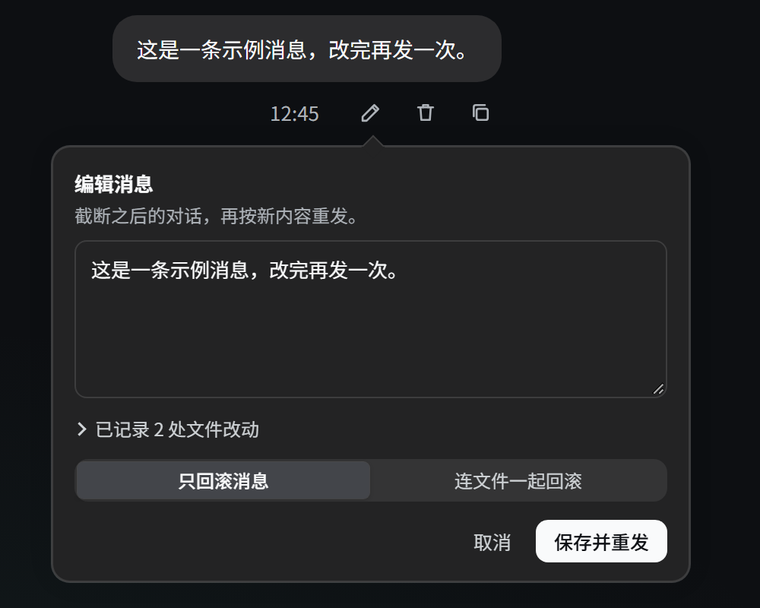
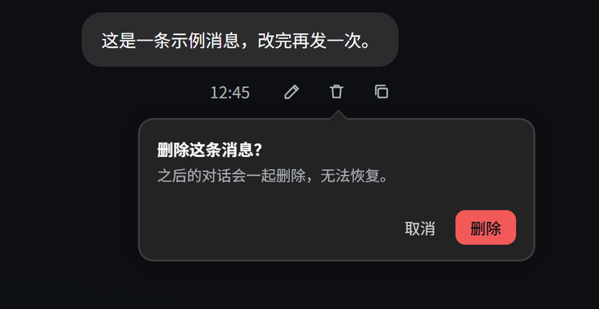
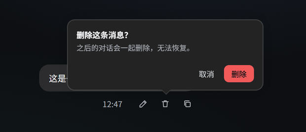
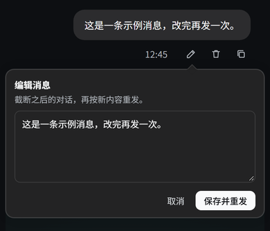
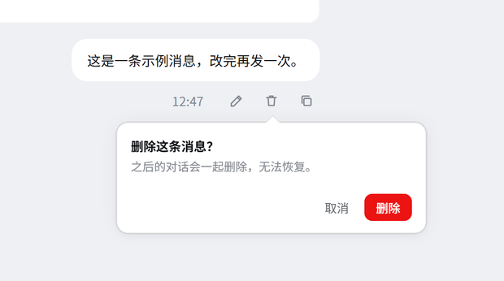

# dsh-message-rewind

[简体中文](README.md) | **English**

Edit and delete your own messages in [DeepSeek Harness](https://github.com/deepseek-ai/deepseek-harness).

- Typo in a sent prompt? Fix it, and the conversation continues from the edited text — no need to start over.
- Said something you regret? Delete that message and every turn after it disappears with it.
- Files changed during that turn? Optionally roll them back to the state before the message.

---

## What it does

| You want to | What the plugin does |
| --- | --- |
| Change a sent message | Click the pencil under your bubble, edit the text, then click **Save and resend**. Everything after that message is truncated and the conversation restarts from your edited text. |
| Drop an out-of-line message | Click the trash icon and confirm. That message and every following turn are deleted. |
| Restore files too | When deleting or editing, if that turn recorded file changes and the record is complete, the popover lets you choose **messages only** or **messages and files**. |
| Stay out of a running task | The action is refused while a turn is still running, so it never races the agent's writes. |

Only your regular messages have these buttons; steering rows injected during a running turn do not offer edit/delete. The **Copy** button is still there, in the same position.

## Screenshots

Your own messages get **edit / delete / copy** buttons under the bubble:


The popover opens right under the button you clicked and points at it with a small arrow; click outside or press Esc to dismiss it. The editor reads the file changes recorded after that message as soon as it opens — collapsed into one **N file changes recorded** line unless you expand it — and a two-way switch decides whether files are restored too. When the record is incomplete the switch is not offered, so only a messages-only rollback is possible:

| Edit popover | Delete confirmation |
| :---: | :---: |
|  |  |

The popover follows its button: it flips above when there is no room below, narrows to the screen width on small viewports, and keeps the same layering in the light theme:

| Flips above near the bottom | Narrow screen (390px) | Light theme |
| :---: | :---: | :---: |
|  |  |  |

When file changes were recorded, snapshot and Git-worktree limits are shown in the popover itself, not after a failed operation.

## Install

Requires DSH 0.2.2-rc.1 or newer (0.2.x) and Node.js ≥ 20; verified on 0.2.2-rc.1. DSH validates `engines.dsh` at startup and refuses to load the plugin on an older host.

### From npm (recommended)

Published on npm as [dsh-message-rewind](https://www.npmjs.com/package/dsh-message-rewind), and listed in the [plugin market](https://awesome-dsh-plugin.com/p/xCube007/dsh-message-rewind/).

One command:

```bash
dsh plugin --profile web add dsh-message-rewind
```

Or install from inside DSH: **Settings → Plugins → search `dsh-message-rewind`**.

If you prefer editing the profile yourself, the manual route is the same three steps:

1. Add the dependency to your profile's `package.json` (`~/.dsh/profiles/<profile>/package.json`):

   ```json
   {
     "dependencies": {
       "dsh-message-rewind": "^1.2.3"
     }
   }
   ```

2. Register the plugin in the same profile's `cordis.patch.yml`:

   ```yaml
   - insert:
       - id: message-rewind
         name: 'dsh-message-rewind'
   ```

3. Run `pnpm install` in that profile directory, then restart DSH (or enable it under **Settings → Plugins**).

### From source (if you want to change the code)

```bash
git clone https://github.com/xCube007/dsh-message-rewind.git D:/Code/dsh-message-rewind
```

Use a link dependency; the remaining steps are the same:

```json
"dsh-message-rewind": "link:D:/Code/dsh-message-rewind"
```

### After installing

The DSH startup log lists `message-rewind` as active. Refresh the page and your own message bubbles get **edit / delete / copy** buttons.

## Usage

1. Click the pencil → a popover opens under the button; change the text and click **Save and resend**.
2. Click the trash icon → click **Delete** to remove that message and every following turn.
3. The popover reads the file changes recorded after that message as soon as it opens and keeps them collapsed into one line; when files changed and their record is complete it also offers a two-way **Rollback scope**:
   - **Messages only** (default) — leave files untouched;
   - **Messages + files** — restore files to their content before that message;
   - pick the scope, then click **Save and resend** or **Delete**.

Lost or truncated snapshots, queued prompts, and non-Git workspaces are called out in one-line notes inside the popover.

## File rollback: what can and cannot be restored

**Can be restored:** creating, modifying, and deleting text files — including combinations within one turn, such as "create then delete".

**When it cannot, the plugin fails loudly instead of skipping silently:**

| Situation | Result |
| --- | --- |
| Binary file | Cannot be restored (only text diffs are recorded) |
| A file exceeds the recorder's text size limit | No content was kept to compare, so it cannot be restored |
| Workspace is not a Git repository and the file was changed by a shell command | Not recorded, so it cannot be restored. Run `git init` in that directory to record everything. |
| A turn changed more files than the record cap (500 by default) | The record is truncated, so the snapshot counts as incomplete and only messages can be rolled back |
| Session restarted or released, so earlier snapshots expired | You are told the snapshot is unavailable or the record was truncated; messages-only rollback still works |
| The file was changed again after being recorded (by you or another tool) | Rollback is **refused** rather than overwriting your later changes |
| The conversation has no workspace | Messages-only rollback |

## FAQ

**Q: Does the sidebar get an extra conversation after a rollback?**
No — there is always just one conversation, and its title normally carries over. The underlying session ID does change, though: DSH session logs are append-only and have no "delete a middle chunk" API, so the plugin forks a truncated branch, archives the original out of the sidebar, and deletes its log directory. If you referenced that session ID elsewhere, fetch it again. When the first message is deleted, the replacement is a new conversation that has not been titled yet, so it may show the default title.

**Q: Can the original record be recovered?**
Normally it is deleted. Only when its log directory is still held open and cannot be removed does the original stay in the archive.

**Q: Why can't messages with attachments be edited?**
Attachments are stored as part of the message content, and editing only supports plain-text messages. Messages with attachments can still be deleted.

**Q: The edit and delete buttons are greyed out with a "turn is still running" note?**
Stop the running task first; the buttons stay disabled until the turn ends. Also note that queued prompts are discarded together with the deleted record — the popover warns you about this.

**Q: I don't see the buttons.**
Check that the plugin is enabled under **Settings → Plugins** and that you refreshed the page. Only messages you sent have these buttons.

## Uninstall

Remove the `dsh-message-rewind` dependency from your profile's `package.json`, delete the matching `insert` entry from `cordis.patch.yml`, run `pnpm install`, and restart DSH.

## Feedback

Found a bug or want a feature? Open an [issue](https://github.com/xCube007/dsh-message-rewind/issues).

## Development

To change the code or cut a release, see [CONTRIBUTING.md](https://github.com/xCube007/dsh-message-rewind/blob/main/CONTRIBUTING.md) (in Chinese).

## License

MIT
