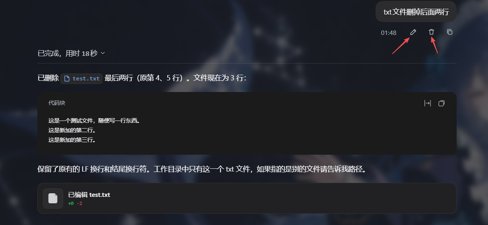
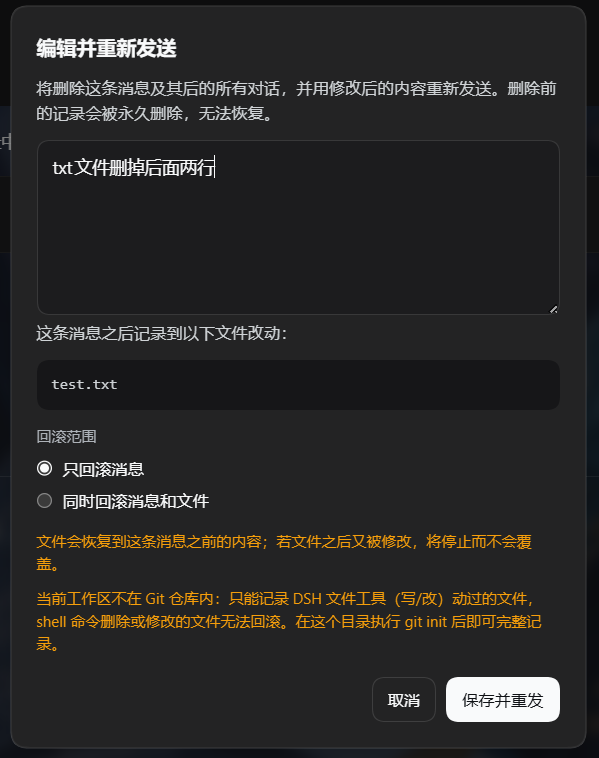
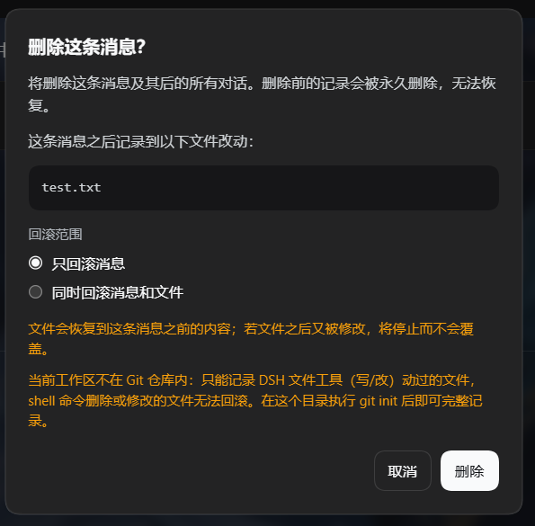

# dsh-message-rewind

**简体中文** | [English](README.en.md)

给 [DeepSeek Harness](https://github.com/deepseek-ai/deepseek-harness) 的消息气泡加两个按钮：**编辑**和**删除**。

- 发错字了？改一下，直接从改后的内容重新开始，不用重开对话。
- 说话越界了？删掉这条，它之后的所有对话一起消失。
- 那一轮还改过文件？可以顺手把文件也还原到这条消息之前的样子。

> A DSH plugin that adds **edit** and **delete** to your own message bubbles. Deleting truncates every following turn and can optionally roll the recorded file changes back.

---

## 它能做什么

| 你想要的 | 插件怎么帮你 |
| --- | --- |
| 改掉已发送的消息 | 点消息气泡下方的铅笔，改完点「保存并重发」，这条消息之后的内容会被截断，然后按你改后的内容重新开始 |
| 撤掉一条越界的消息 | 点垃圾桶，确认后这条消息连同它之后的所有对话一起删除 |
| 连文件一起还原 | 删除/编辑时，如果那一轮动过文件，弹窗会让你选「只回滚消息」还是「同时回滚消息和文件」 |
| 不打扰正在跑的任务 | 有未结束的轮次时直接拒绝操作，不会和正在执行的 turn 抢写 |

只有你自己发出的消息才有这两个按钮；「复制」按钮仍在，位置不变。

## 界面

自己发出的消息，气泡下方会多出「编辑 / 删除 / 复制」三个按钮：



编辑弹窗打开时就会列出这条消息之后记录到的文件改动，并用「回滚范围」决定要不要连文件一起还原：

| 编辑弹窗 | 删除确认 |
| :---: | :---: |
|  |  |

快照失效、工作区不在 Git 仓库等限制也会直接标在弹窗里，不用等到操作失败才知道。

## 安装

需要 DSH 0.2.1-rc.3 及以上（0.2.x），Node.js ≥ 20；已在 0.2.1-rc.5 上验证。宿主启动时会按 `engines.dsh` 校验，低于该版本会拒绝加载。

### 从 npm 安装（推荐）

1. 在 profile 的 `package.json`（`~/.dsh/profiles/<profile>/package.json`）里加依赖：

   ```json
   {
     "dependencies": {
       "dsh-message-rewind": "^1.1.1"
     }
   }
   ```

2. 在同一个 profile 的 `cordis.patch.yml` 里挂上插件：

   ```yaml
   - insert:
       - id: message-rewind
         name: 'dsh-message-rewind'
   ```

3. 在该 profile 目录执行 `pnpm install`，然后重启 DSH（或在「设置 → 插件」里启用）。

### 从源码安装（想改代码时用）

```bash
git clone https://github.com/xCube007/dsh-message-rewind.git D:/Code/dsh-message-rewind
```

依赖写成链接形式，其余步骤相同：

```json
"dsh-message-rewind": "link:D:/Code/dsh-message-rewind"
```

### 装好之后

DSH 启动日志里会出现 `message-rewind` 且状态为 active；刷新页面，你自己消息的气泡下方就会多出「编辑 / 删除 / 复制」三个按钮。

## 使用

1. 点铅笔 → 弹出编辑框，改完点「保存并重发」。
2. 点垃圾桶 → 点「删除」，删除这条消息及其后的全部对话。
3. 弹窗打开时就会读取这条消息之后记录到的文件改动，并列出来；有改动（或快照已失效）时，弹窗里会多出一个「回滚范围」：
   - **只回滚消息**（默认）：文件保持现状；
   - **同时回滚消息和文件**：文件恢复成这条消息之前的内容；
   - 选好范围后，点「保存并重发」或「删除」执行。

无论选哪个，弹窗里都会明确告诉你这次操作会丢掉哪些内容、以及文件回滚会不会被拒绝。

## 文件回滚：什么能回、什么回不了

**能回**：文本文件的新建、修改、删除——包括同一轮里「先新建再删掉」这类组合。

**回不了时会直接报错，不会静默跳过**：

| 情况 | 结果 |
| --- | --- |
| 二进制文件 | 无法回滚（只记录了文本 diff） |
| 工作区不在 Git 仓库内，且文件是被 shell 命令改的 | 无法记录，因而无法回滚；在该目录 `git init` 后可完整记录 |
| 会话重启或释放后，早先的快照已过期 | 提示「部分改动快照已不可用」，此时只能只回滚消息 |
| 文件在记录之后又被你（或别的工具）改过 | 回滚会被**拒绝**，不会覆盖掉你后来的改动 |
| 这个会话没有工作区 | 只能只回滚消息 |

## 常见问题

**Q：回滚之后，侧边栏是不是会多出一条对话？**
不会，始终只有一条同名对话。但底层会话 ID 会变：DSH 的会话日志是只追加的，没有「删掉中间一段」的接口，插件只能 fork 出一个截断后的分支，再把原会话移出侧边栏并删除其日志目录。所以如果你在别处引用过这个会话 ID，需要重新取一次。

**Q：原会话的记录还能找回吗？**
正常情况下会被删除。只有当日志目录被占用删不掉时，原会话会保留在归档里。

**Q：为什么带附件的消息不能编辑？**
附件是作为消息内容的一部分存下来的，编辑只支持纯文本消息。带附件的消息可以删除。

**Q：点按钮提示「当前有未结束的轮次」？**
先停止正在运行的任务再操作。另外，如果有排队中的消息，它们会随被删除的记录一起作废——弹窗里会提示。

**Q：看不到按钮？**
确认插件已在「设置 → 插件」里启用、并且刷新过一次页面；另外只有你自己发的消息才有这两个按钮。

## 卸载

从 profile 的 `package.json` 里删掉 `dsh-message-rewind` 依赖，并删掉 `cordis.patch.yml` 里对应的 `insert` 段，`pnpm install` 后重启 DSH。

## 反馈

遇到问题或想加功能，欢迎提 [Issue](https://github.com/xCube007/dsh-message-rewind/issues)。

## 开发

想改代码或自己发版，看 [CONTRIBUTING.md](https://github.com/xCube007/dsh-message-rewind/blob/main/CONTRIBUTING.md)。

## License

MIT
